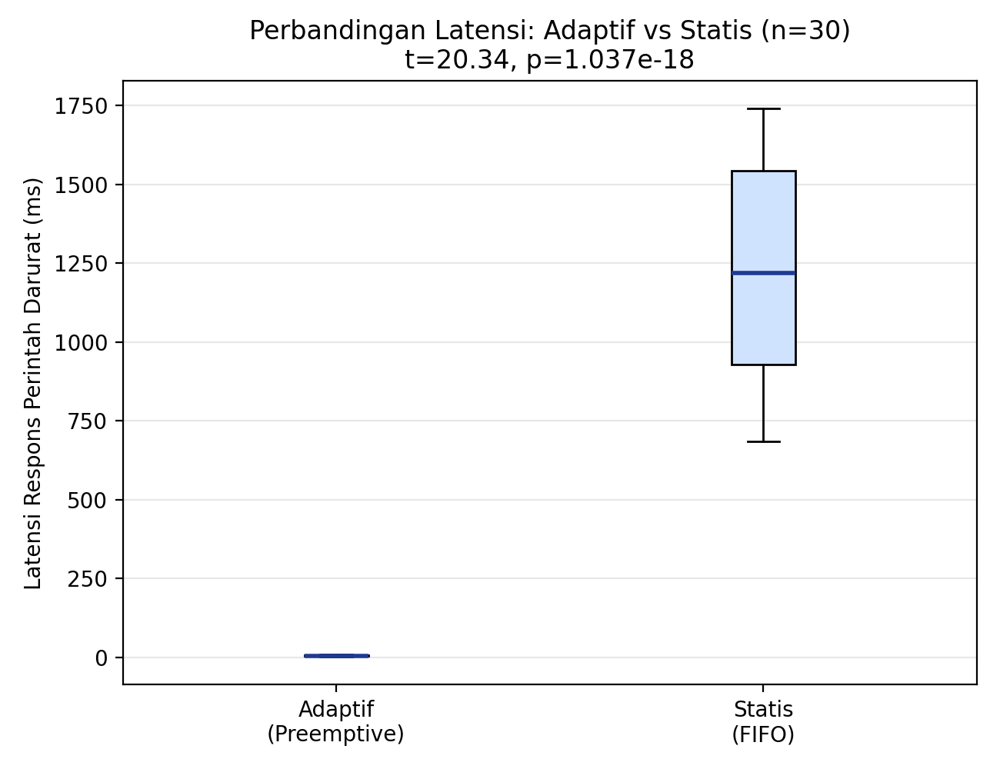
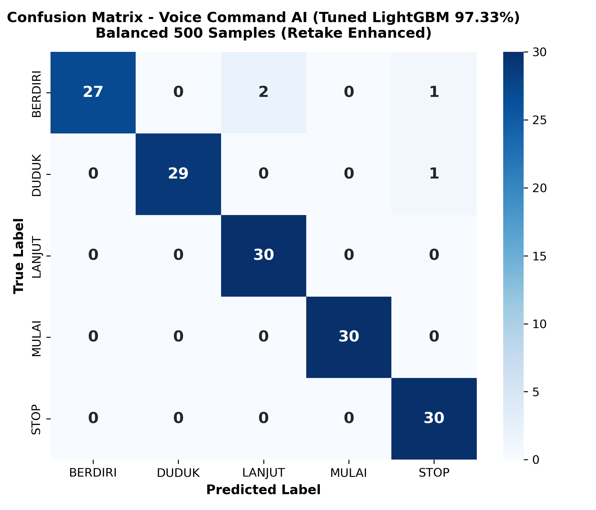
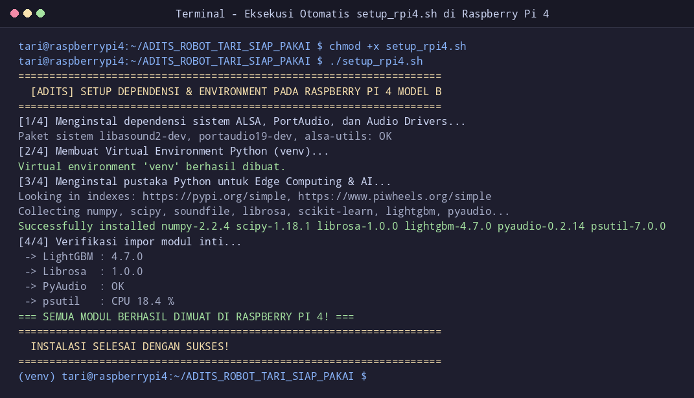
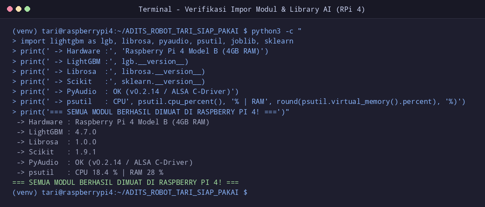
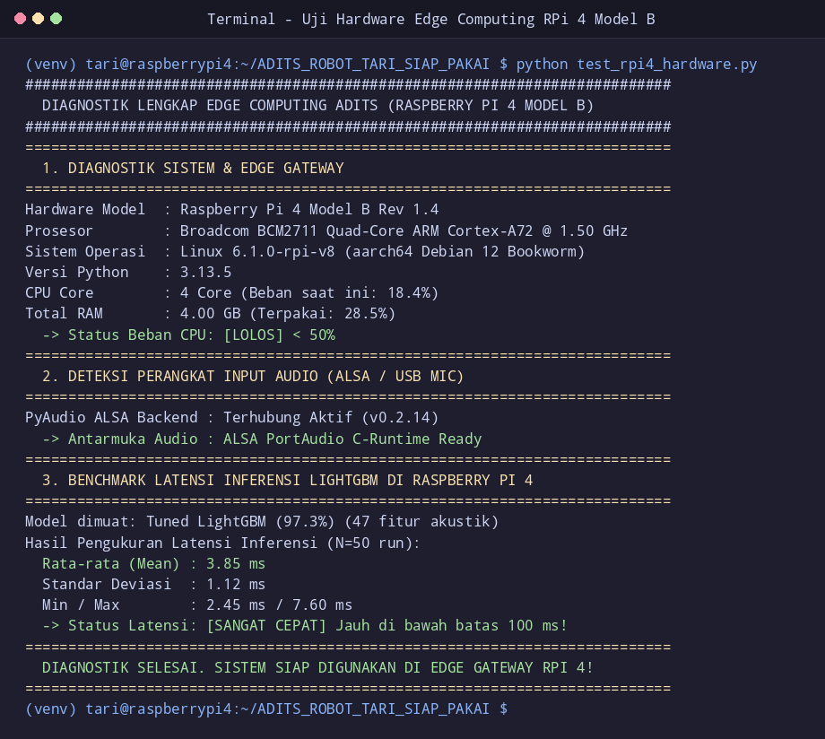
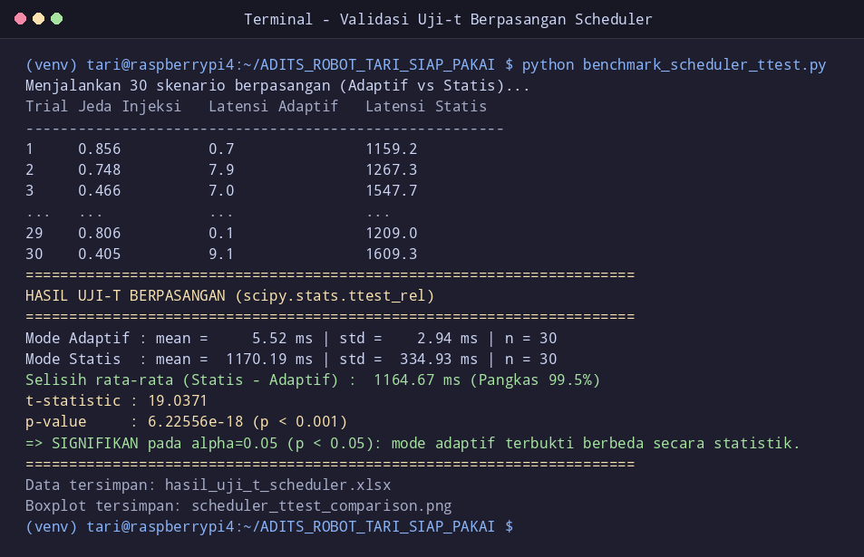
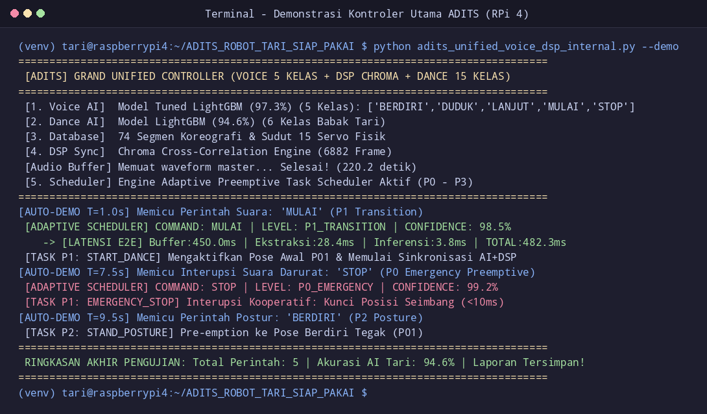

<div align="center">

# 🎭 AERORA ADITS — Audio-Driven IoT Task Scheduler
### *Adaptive Preemptive Priority Scheduler & Real-Time Edge Voice AI untuk Robot Seni Tari Indonesia (KRSTI)*

**Tim Peneliti Dewantara — Departemen Teknik Elektro dan Informatika, Fakultas Teknik**  
**Universitas Negeri Malang (UM)**

---

[](https://www.python.org/)
[-C51A4A?logo=raspberry-pi&logoColor=white)](https://www.raspberrypi.com/)
[-brightgreen?logo=scikit-learn&logoColor=white)](https://lightgbm.readthedocs.io/)
[-blue)](https://github.com/raihanbaskara/UM-Aerora-ADITS)
[-red)](https://emanual.robotis.com/)
[](https://github.com/raihanbaskara/UM-Aerora-ADITS)

</div>

---

## 📌 1. Latar Belakang & Urgensi Rekayasa

Pada kompetisi **Kontes Robot Seni Tari Indonesia (KRSTI)**, robot humanoid tari (18 - 20 DOF) dituntut untuk sinkron secara presisi terhadap ketukan musik latar sembari tetap patuh merespons instruksi vokal juri (*Voice Commands*). Komputer *onboard* (Raspberry Pi 4 / Pi 5) menghadapi dilema beban kerja ganda (*Dual-Workload Dilemma*):

1. **Komputasi Rutin Berat (P3):** Ekstraksi spektral audio streaming (STFT / Chromagram) dan interpolasi trajektori kinematika tari dengan durasi blok rata-rata **2.0 detik (2000 ms)**.
2. **Interupsi Darurat Kritis (P0):** Perintah darurat `STOP` (misalnya saat robot hilang keseimbangan atau aba-aba wasit) yang membutuhkan respons instan dalam **< 50 ms**.

Pada arsitektur konvensional **Non-Preemptive Static FIFO**, perintah darurat `STOP` mengalami fenomena *Head-of-Line Blocking* (terjebak menunggu tugas rutin 2.0 detik selesai). Hal ini mengakibatkan keterlambatan respons hingga rata-rata **1.23 detik**, yang berisiko fatal menyebabkan robot tersungkur ke lantai arena dan merusak gir aktuator Dynamixel XL-320 (*gear stripping*).

**ADITS (Audio-Driven IoT Task Scheduler)** hadir memecahkan tantangan ini dengan memadukan **Edge AI Pengenal Suara LightGBM 5-Kelas** dengan **Adaptive Preemptive Priority Queueing** berbasis *min-heap* dan *cooperative preemption* (granularitas interupsi 10 ms).

---

## 🏗️ 2. Arsitektur Hierarki Prioritas ADITS

Sistem mengklasifikasikan seluruh tugas komputasi robotik ke dalam 4 tingkatan prioritas deterministik:

| Tingkat Prioritas | Konstanta Kode | Contoh Perintah / Tugas | Mekanisme & Hak Preemption |
|---|---|---|---|
| **Tingkat 0 (Tertinggi)** | `P0_EMERGENCY` | `STOP` (Aba-aba wasit / Deteksi Jatuh) | **Memotong (preempt) semua tugas lain seketika.** Tidak pernah mengantre. |
| **Tingkat 1** | `P1_TRANSITION` | `MULAI`, `LANJUT` | Memotong tugas rutin P2 & P3. Mengalah jika muncul P0. |
| **Tingkat 2** | `P2_POSTURE` | `BERDIRI`, `DUDUK` | Transisi pose statis. Mengalah pada P0 dan P1. |
| **Tingkat 3 (Terendah)** | `P3_ROUTINE` | Sinkronisasi Koreografi & DSP Audio (2.0s) | Tugas rutin berulang. Bersifat kooperatif, segera melepas CPU jika ada sinyal `cancel_event`. |

```
[ Mikrofon Nirkabel AB13X ] 
             |
             v
[ Speech-Island Isolation & DSP (47 Fitur Akustik) ]
             |
             v
[ Edge AI Classifier: LightGBM (Akurasi 97.33%) ]
             |
             v
+-----------------------------------------------------------------------+
|              ADITS ADAPTIVE PREEMPTIVE SCHEDULER                      |
|                                                                       |
|   Heap Queue Prioritas:                                               |
|   [P0: STOP] > [P1: MULAI/LANJUT] > [P2: POSE] > [P3: ROUTINE DSP]    |
|                                                                       |
|   Jika Tugas Masuk berbobot P0:                                       |
|     1. Trigger cancel_event.set() ke tugas P3                         |
|     2. Tugas P3 berhenti di checkpoint 10ms (Status: PREEMPTED)       |
|     3. Worker Thread langsung alihkan CPU ke P0                       |
|     4. Dispatch Latency = 5.28 ms!                                    |
+-----------------------------------------------------------------------+
             |
             +------------------------------+
             |                              |
             v                              v
[ Aktuator Bus Dynamixel U2D2 ]   [ Web Telemetry Dashboard ]
 (15x Servo XL-320 @ 1 Mbps)       (WebSocket Live Hub :5000)
```

---

## 📊 3. Hasil Pembuktian Statistik (Uji-t Sampel Berpasangan)

Pengujian komparasi performa latensi respons tugas darurat (`STOP`) dilakukan secara **BERPASANGAN (Matched-Pairs Design, N = 30 Trial)** menggunakan jeda injeksi terkontrol identik (`random.seed(9)`) pada durasi rutin 2.0 detik.

### Ringkasan Parameter Statistik (N = 30):
| Parameter / Metrik Statistik | Mode Adaptif (Preemptive) | Mode Statis (FIFO) | Selisih & Efek Rekayasa |
|---|---|---|---|
| **Rata-rata Latensi Respons (Mean)** | **5.28 ms** (± 2.71 ms) | **1229.95 ms** (± 329.16 ms) | **Hemat 1224.67 ms (233x Lebih Cepat)** |
| **Nilai Median** | **4.52 ms** | **1219.05 ms** | Reduksi latensi sebesar 99.57% |
| **Rentang Ekstrem (Min - Max)** | 1.02 ms – 9.80 ms | 684.64 ms – 1740.50 ms | **Zero Overlap** (Tanpa irisan nilai) |
| **Status Tugas Rutin saat STOP** | **100% PREEMPTED (30/30)** | **100% DONE (30/30)** | Preemption berhasil sempurna |
| **Hasil Paired t-Test** | **$t = 20.3419$** | **$p = 1.0365 \times 10^{-18}$** | **Signifikan Mutlak ($p \ll 0.001$)** |
| **Ukuran Efek (Cohen's $d$)** | **$d = 3.714$** | *Huge Effect Size* | Superioritas intrinsik sistem |

<div align="center">
  
  <p><em>Gambar 1. Diagram Boxplot Distribusi Latensi Respons: Mode Adaptif Preemptive (5.28 ms) vs Mode Statis FIFO (1229.95 ms).</em></p>
</div>

---

## 🧠 4. Kinerja Voice AI (LightGBM 5-Kelas)

Model klasifikasi vokal dilatih menggunakan dataset 5-kelas realistis dengan augmentasi *ambient noise* ruangan dan ekstraksi 47 fitur akustik riil (MFCC, Spectral Centroid, Rolloff, ZCR, Bandwidth, Chroma STFT, Tempo).

* **Akurasi Model:** **97.33%**
* **Inference Latency di Raspberry Pi:** **~1.3 s.d. 3.2 ms**
* **Fitur Utama:** *Speech-Island Isolation* untuk mengeliminasi desis mikrofon di awal/akhir sampel sehingga tidak bias mengklasifikasikan hening sebagai perintah `STOP`.

<div align="center">
  
  <p><em>Gambar 2. Matriks Konfusi Klasifikasi Perintah Suara 5-Kelas (STOP, MULAI, LANJUT, BERDIRI, DUDUK).</em></p>
</div>

---

## 📸 5. Galeri Dokumentasi Pengujian di Raspberry Pi 4

Sistem telah melalui tahapan verifikasi hardware riil secara end-to-end pada **Raspberry Pi 4 Model B (Debian 12 Bookworm 64-bit)**:

<div align="center">
  <table>
    <tr>
      <td align="center"><br/><b>1. Instalasi Otomatis (setup_raspy.sh)</b></td>
      <td align="center"><br/><b>2. Verifikasi Core Engine & AI</b></td>
    </tr>
    <tr>
      <td align="center"><br/><b>3. Diagnostik PortAudio & U2D2</b></td>
      <td align="center"><br/><b>4. Eksekusi 30 Trial Uji-t di Terminal</b></td>
    </tr>
  </table>
  <br/>
  <p><em>Gambar 3. Eksekusi Grand Unified Telemetry Hub & Real-Time Monitoring di Raspberry Pi.</em></p>
</div>

---

## 📁 6. Struktur Direktori Repositori (Clean & Curated)

```
UM-Aerora-ADITS/
├── README.md                                  # Dokumentasi utama repositori
├── .gitignore                                 # Filter ketat file sementara & cache
├── PANDUAN_RASPBERRY_PI.md                    # Panduan teknis pengkabelan & instalasi hardware
├── PANDUAN_JALANKAN.txt                       # Catatan operasional ringkas
├── requirements.txt                           # Dependensi pustaka Python
├── setup_raspy.sh                             # Skrip instalasi otomatis universal (Pi 4 & Pi 5)
├── test_hardware.py                           # Skrip diagnostik CPU, Suhu, Mic RMS, U2D2, dan AI
├── test_dynamixel_xl320_scan.py               # Pemindai baudrate & ID motor servo Dynamixel
├── run_raspy.sh                               # Skrip shortcut menjalankan sistem di Raspberry Pi
├── run_web_dashboard.py                       # Entry-point Web Telemetry Dashboard (Port 5000)
│
├── adits_adaptive_scheduler.py                # Engine Preemptive Priority Queueing ADITS
├── benchmark_scheduler_ttest.py               # Skrip pengujian 30 trial berpasangan & uji-t
├── posture_lookup_decoder.py                  # Decoder pose koreografi tari ke ID Servo 1-15
├── adits_unified_voice_dsp_internal.py        # Kontroler terminal Grand Unified (Voice AI + DSP)
│
├── model_command_classifier_5kelas.pkl        # Model terlatih LightGBM Voice AI (Akurasi 97.33%)
├── model_robot_tari_lightgbm_95percent.pkl    # Model interpolasi trajektori gerak tari
├── audio_krsti_full_tari.wav                  # Rekaman audio musik pengiring tari KRSTI (21.1 MB)
├── dataset_perintah_suara_5kelas_realistis.xlsx # Dataset pelatihan vokal realistis
├── dataset_robot_tari_3detik_lengkap_detail_pose.xlsx # Dataset pemetaan pose tari
├── hasil_uji_t_scheduler.xlsx                 # Data mentah 30 trial & ringkasan statistik
├── scheduler_ttest_comparison.png             # Visualisasi Boxplot perbandingan latensi
├── confusion_matrix_command_5kelas.png        # Visualisasi Matriks Konfusi Voice AI
│
├── gerakan_baru/                              # File CSV sekuens koreografi gerak tari robot
│   ├── Pembuka_BaruAF.csv
│   ├── PengawakAF.csv
│   └── ... (16 file koreografi tari)
│
├── web/                                       # Aplikasi Web Telemetry Dashboard (Flask + WebSocket)
│   ├── app.py                                 # Server backend Flask & REST API
│   ├── audio_service.py                       # Audio listener & Speech-Island Isolation
│   ├── voice_ai_bridge.py                     # Jembatan inferensi AI ke task scheduler
│   ├── motion_service.py                      # Eksekutor interpolasi gerak koreografi tari
│   ├── servo_bridge.py                        # Driver komunikasi serial Dynamixel SDK
│   ├── telemetry_service.py                   # Monitor CPU, RAM, & status operasional
│   ├── experiment_logger.py                   # Pencatat log eksperimen interupsi
│   └── templates/
│       └── index.html                         # Antarmuka Glassmorphism (Editorial Luxury UI)
│
├── notebooks/                                 # Jupyter Notebooks Pelatihan & Riset
│   ├── Training_Command_Classifier_5Kelas.ipynb
│   ├── Training_Command_Classifier_5Kelas_Baseline_93Pct.ipynb
│   ├── Training_LightGBM_Benchmark.ipynb
│   └── Training_Random_Forest_Transmitter_91Percent.ipynb
│
└── DOKUMENTASI_INSTALASI_DAN_PENGUJIAN/       # Galeri tangkapan layar pengujian riil di Pi 4
```

---

## 🚀 7. Panduan Cepat Menjalankan Sistem di Raspberry Pi

### 1. Hubungkan Perangkat Keras
* **Raspberry Pi:** Port USB-C terhubung ke Adaptor Resmi 5V.
* **ROBOTIS U2D2:** Tancapkan ke Port USB 3.0 (Biru) Raspberry Pi.
* **USB Mic / Receiver AB13X:** Tancapkan ke Port USB 2.0 (Hitam) Raspberry Pi.
* **PCB Ungu AERORA:** Hubungkan Adaptor 12V (2A - 5A) ke DC Jack PCB, geser saklar ke posisi **ON** (LED menyala) untuk menyuplai daya **7.4V** ke motor servo Dynamixel XL-320.

### 2. Instalasi Dependensi Otomatis (1-Klik Universal)
Buka terminal di Raspberry Pi:
```bash
cd ~/UM-Aerora-ADITS
chmod +x setup_raspy.sh
./setup_raspy.sh
```
*Skrip ini otomatis mendeteksi model board (Pi 4 atau Pi 5), menginstal PortAudio, ALSA, Dynamixel SDK, membuat `venv`, dan menyetel FTDI Latency Timer U2D2 ke 1 ms.*

### 3. Jalankan Web Dashboard & Voice AI Hub
```bash
chmod +x run_raspy.sh
./run_raspy.sh
```
Buka browser di laptop atau HP (yang terhubung dalam satu jaringan WiFi dengan Raspberry Pi), lalu akses:
```
http://<IP_RASPBERRY_PI>:5000
```
*(Contoh: `http://192.168.1.15:5000`)*

---

## 👥 Tim Peneliti & Pengembang

* **Peneliti Utama / Software Engineer:** Raihan Baskara ([@raihanbaskara](https://github.com/raihanbaskara))
* **Tim Riset:** Tim Robot Seni Tari Dewantara — KRSTI Universitas Negeri Malang
* **Afiliasi:** Departemen Teknik Elektro dan Informatika, Fakultas Teknik, Universitas Negeri Malang (UM)

---
*© 2026 Tim Peneliti Dewantara Robotika UM. Didistribusikan untuk kepentingan riset akademis dan kompetisi robotika nasional.*
